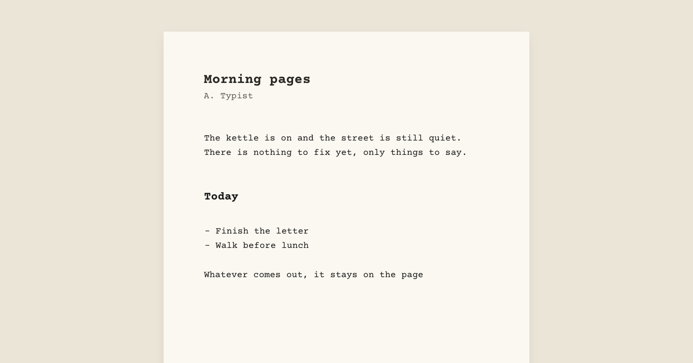
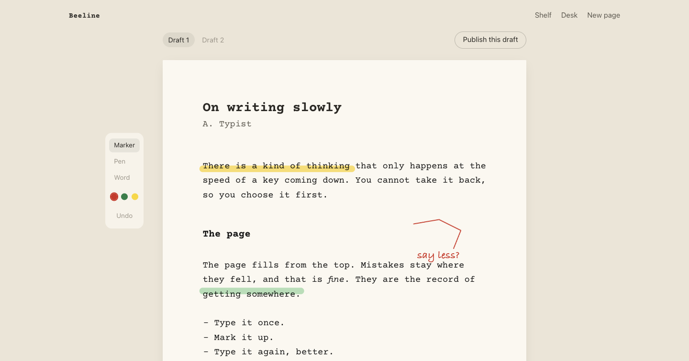
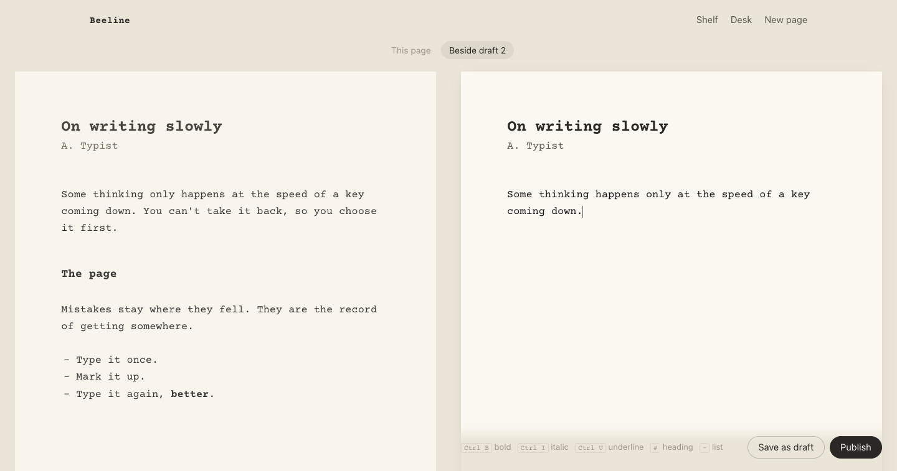
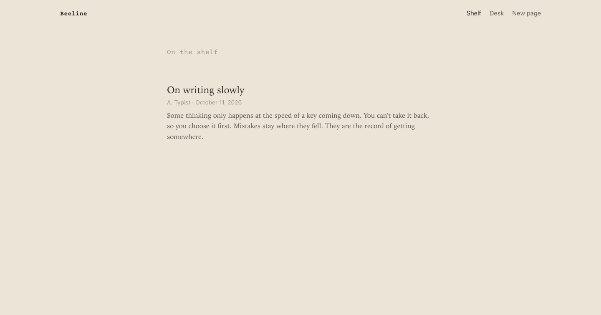
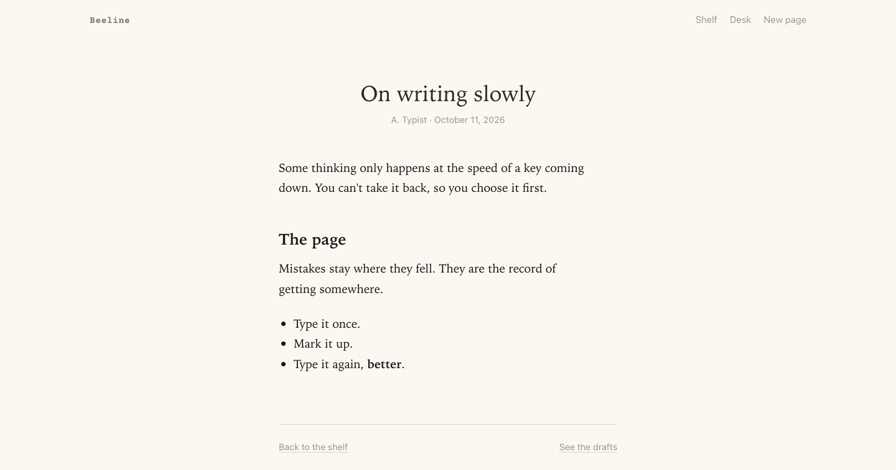

# Beeline

A calm place to type. No toolbar, no backspace: you make a beeline from the
first word to the last, mark the page up with a pen, and type it again.



- **Write**: title, author and body. Ctrl+B/I/U, `#` for headings, `-` for bullets.
- **Mark up** a draft with a marker, a pen, or words placed on the page.
- **Redraft** beside the previous draft, then **publish** to the shelf.
- **Offline**: pages are kept on the device and saves wait in an outbox until
  the host is back.

## A tour

**Mark up a draft.** Highlight words with the marker, draw with the pen, or
place a word in the margin. Red, green or yellow. Ink dries when you leave the
page.



**Type the next draft beside the last one.** Or hide it and see only the page
you're on.



**Publish to the shelf.** Typescript becomes print.





## Running it

```sh
bin/setup
bin/rails db:seed   # an example paper (development only)
bin/dev
```

## Serving from a sub-path

To serve Beeline from a path like `example.com/write`, pass
`RAILS_RELATIVE_URL_ROOT` when building the image. It's baked into the
compiled assets and set for the running app:

```sh
docker build --build-arg RAILS_RELATIVE_URL_ROOT=/write -t beeline .
```

Then proxy `/write/` to the container without stripping the prefix.

## Notes

- The service worker only runs in a secure context: `localhost` or HTTPS.
  Serving over plain http on a local network needs a certificate (Caddy's
  internal CA, mkcert, or Tailscale) for offline mode to work.
- There's no sign-in. Anyone who can reach the host can write and publish.
- Typeset in [Courier Prime](https://github.com/quoteunquoteapps/CourierPrime) (SIL OFL, see `app/assets/fonts/OFL.txt`).
